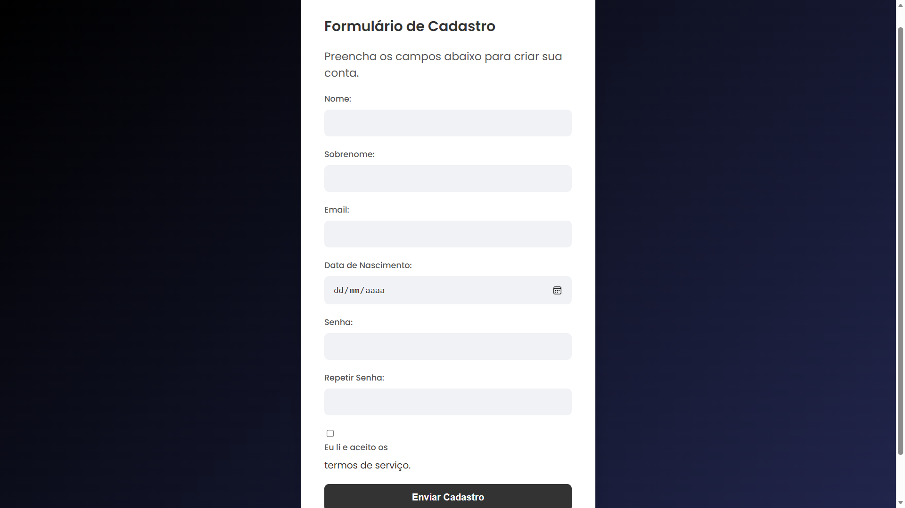
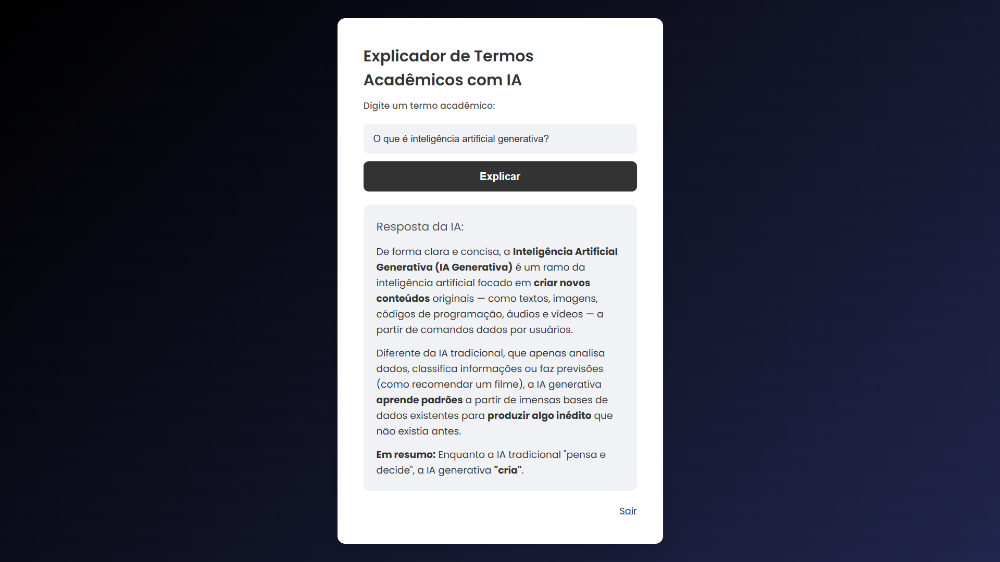

# Explicador Acadêmico com IA

Aplicação web desenvolvida em PHP que utiliza a API do Google Gemini para explicar termos acadêmicos de forma clara e acessível.

## Objetivo

Facilitar a compreensão de conceitos acadêmicos por meio da integração entre desenvolvimento web e inteligência artificial generativa.

## Demonstração do projeto

### Tela de cadastro

Interface inicial com formulário de cadastro demonstrativo.

### Explicador Acadêmico com IA

Exemplo de consulta sobre inteligência artificial generativa, com explicação produzida pela API Google Gemini.

## Funcionalidades

- Formulário de cadastro demonstrativo com validação de dados.
- Controle de acesso utilizando sessões PHP.
- Consulta de termos acadêmicos com inteligência artificial.
- Integração com a API Google Gemini.
- Tentativa de modelos alternativos em determinadas falhas.
- Formatação das respostas da IA.
- Tratamento de erros de conexão e da API.
- Proteção CSRF nas consultas.

## Tecnologias utilizadas

- PHP
- HTML5
- CSS3
- JavaScript
- Google Gemini API
- cURL
- XAMPP / Apache para desenvolvimento local
- Git e GitHub

## Arquitetura e funcionamento

A aplicação utiliza uma arquitetura web com Back-end em PHP e integração com a API Google Gemini.

1. O usuário informa um termo acadêmico pela interface web.
2. O Back-end PHP recebe e processa a solicitação.
3. A aplicação realiza uma requisição à API Google Gemini utilizando cURL.
4. O modelo de inteligência artificial gera uma explicação sobre o termo informado.
5. O PHP processa a resposta e apresenta o resultado ao usuário.

A integração com a IA é realizada no servidor, permitindo manter as configurações sensíveis fora dos arquivos públicos do repositório.

## Como executar

1. Instale o XAMPP com PHP e Apache.
2. Coloque a pasta do projeto no diretório `htdocs`.
3. Crie o arquivo `config.php` na raiz do projeto.
4. Configure a chave da API do Google Gemini e o modelo desejado.
5. Inicie o Apache.
6. Acesse `http://localhost/meu_explicador-ia/Formulario.html` no navegador.

O arquivo `config.php` contém configurações sensíveis e não deve ser publicado no GitHub.

## Limitações

O cadastro é demonstrativo e os dados do usuário são mantidos apenas durante a sessão PHP. Não há banco de dados nem armazenamento persistente de contas.

O funcionamento das explicações depende de conexão com a internet, chave de API válida e disponibilidade dos modelos do Google Gemini.

## Aprendizados

Este projeto permitiu praticar desenvolvimento Back-end com PHP, consumo de APIs REST, integração com IA generativa, tratamento de erros, gerenciamento de sessões e boas práticas iniciais de segurança.

## Possíveis melhorias

- Implementar autenticação com banco de dados.
- Criar histórico de consultas.
- Adicionar testes automatizados.
- Melhorar a experiência de uso e a interface.

## Finalidade

Projeto acadêmico e de portfólio, desenvolvido para demonstrar conhecimentos práticos em programação Back-end e integração com inteligência artificial.